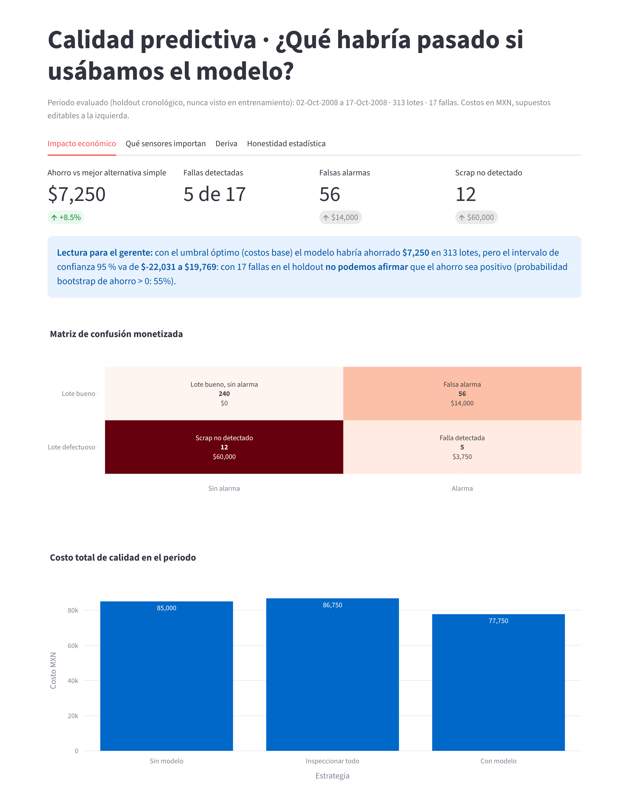
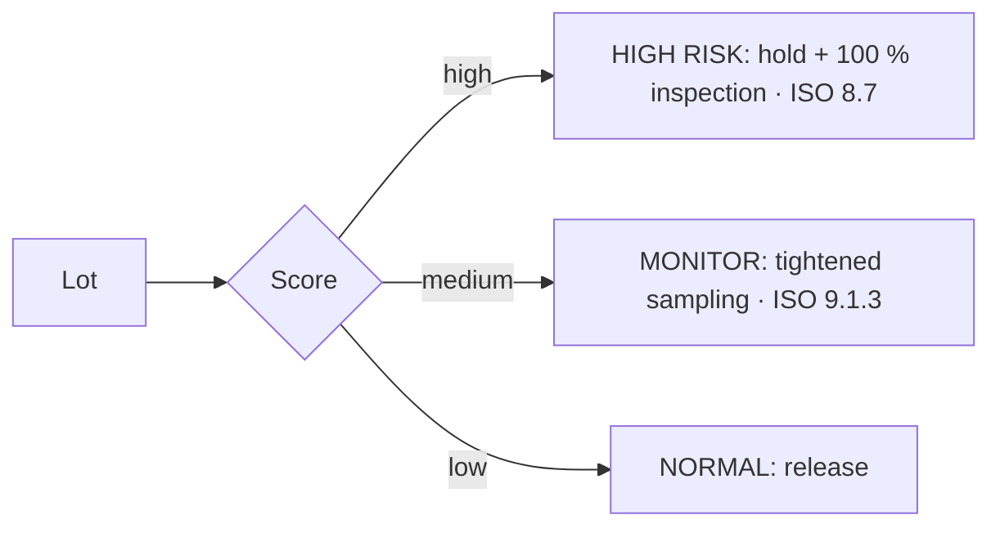
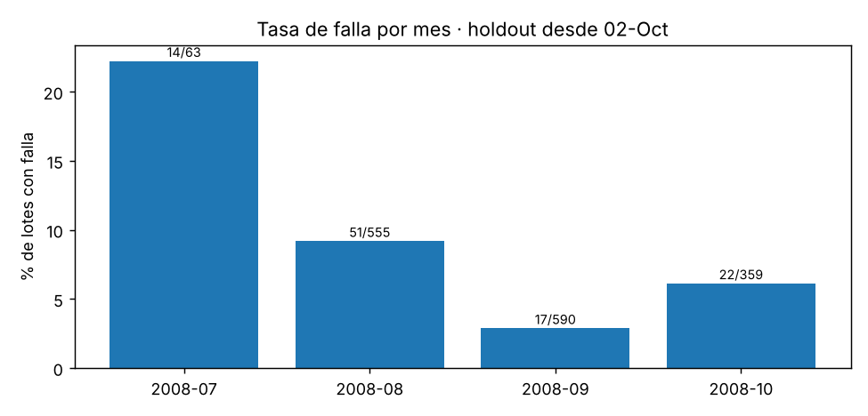
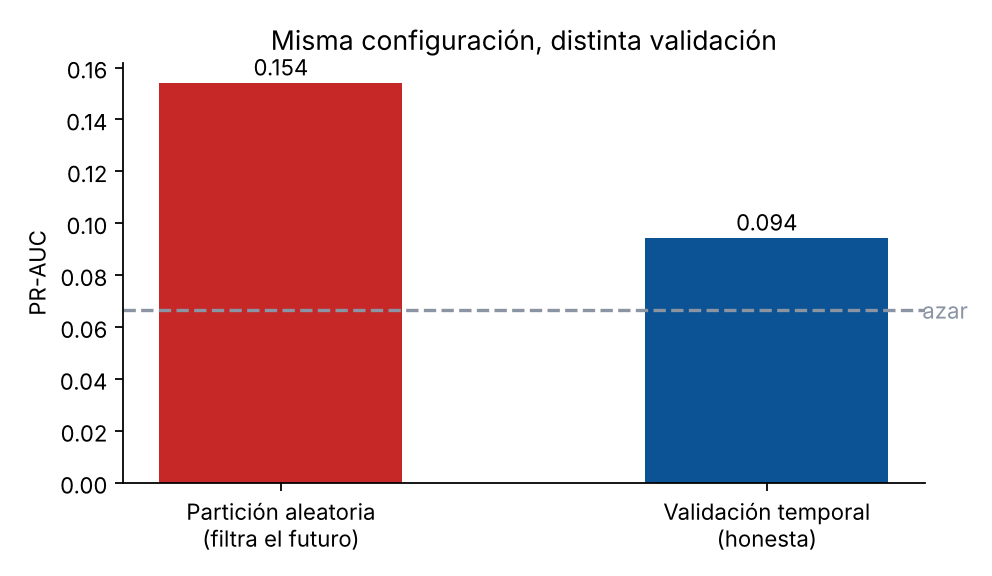
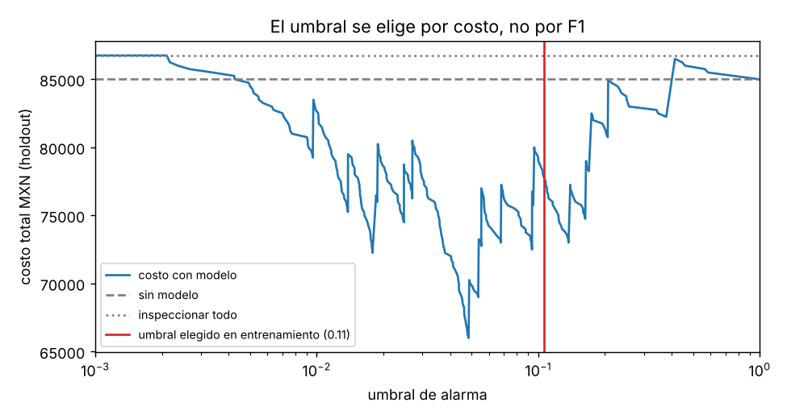
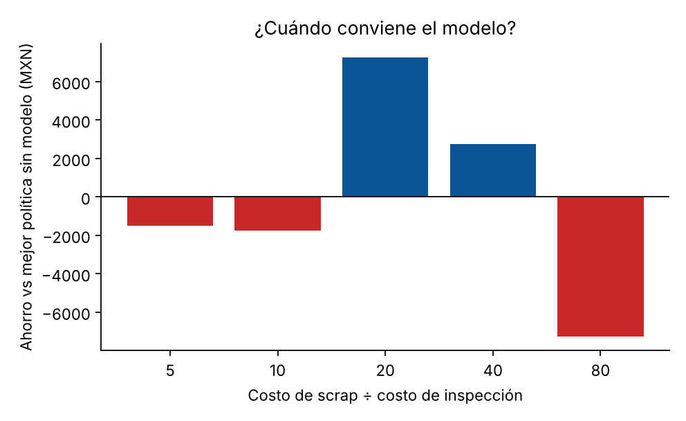
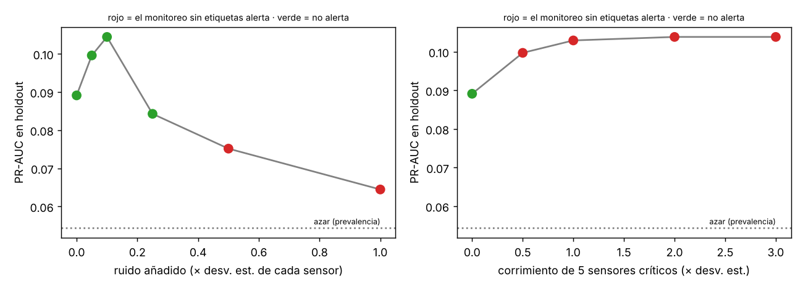
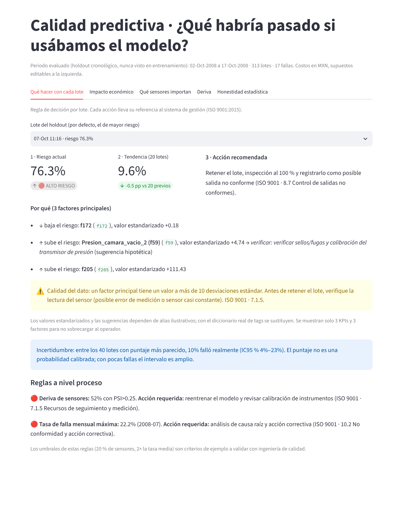
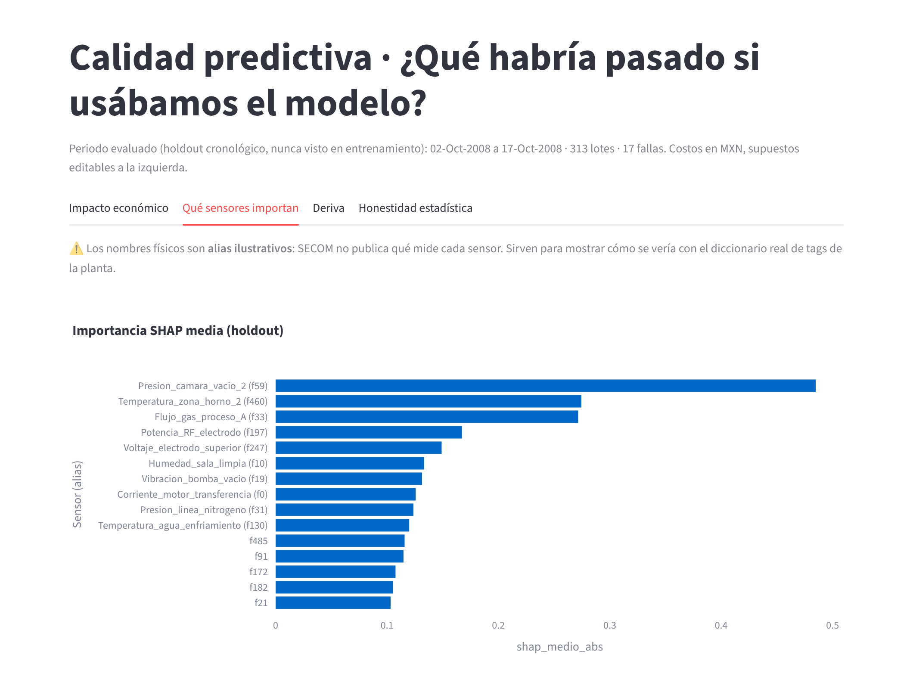

# Predictive Quality · MLOps

*English · [Español](README.es.md)*

**[Live demo](https://huggingface.co/spaces/JesusRLGonzalez/predictive-quality-mlops)** | **[Project page](https://jesusgonzalezmexdata-ux.github.io/predictive-quality-mlops/)**

**An end-to-end decision-support system for industrial quality:** it predicts which semiconductor lots (SECOM) are at risk of failing, translates the result into pesos saved or spent, serves it as an API and a dashboard, and watches its own degradation. Predictive maintenance on NASA C-MAPSS lives in its own repository: [predictive-maintenance-survival-cmapss](https://github.com/jesusgonzalezmexdata-ux/predictive-maintenance-survival-cmapss).

## Executive summary
The system turns data from 590 sensors into a **decision per lot** (release, monitor, hold) with its action and its ISO 9001 reference, measures the effect on **cost of poor quality (COPQ)** and warns when the model stops being reliable. The differentiator is not the algorithm: it is the **decision taxonomy**, the **visible uncertainty** and the **scrutiny log** of what failed and was corrected.

> **What this project shows, and what it does not.** SECOM has a real but weak signal: the model ranks lots better than chance, but the economic saving is **not statistically demonstrated** (95 % CI of the saving: −22k to +20k MXN on 313 lots). It is reported that way on purpose. The contribution is the method, leakage-free validation and the engineering, not an inflated figure.



## Decision taxonomy

The threshold comes from minimising cost, not maximising F1; the middle band exists because the model is weak. Process rules: drift in >20 % of sensors → retrain and check instruments (7.1.5); monthly failure rate >2× the mean → root cause (10.2). Details, sensor families and dictionary: [`docs/TAXONOMIA.md`](docs/TAXONOMIA.md) (Spanish). The dashboard shows each lot with its traffic light, the required action and the observed failure rate of similar lots with its interval (the score is **not** a calibrated probability).

## Challenges and validation (scrutiny log)
| Initial hypothesis | Refutation | Correction |
|---|---|---|
| A random split is fine for evaluation | PR-AUC 0.154 random vs 0.09 temporal: future lots leak in | Expanding windows + a single chronological holdout |
| The model saves money | The 95 % CI of the saving includes zero; negative at cost ratios 5, 10 and 80 | Uncertainty and sensitivity are published; comparison with the best simple alternative |
| SHAP identifies process causes | Only ~52 % of the top 10 survives retraining | Claim withdrawn; aliases marked as hypothetical |
| KNN is clearly the better imputation | 0.094 vs 0.089 vs 0.088, within noise | Declared a practical tie |

More cases in [`docs/ERRORES_Y_PRUEBAS.md`](docs/ERRORES_Y_PRUEBAS.md) (Spanish).

## Design decisions
Five critical questions for a quality system in production, answered with the evidence in this repository (including what did not go well). Figures reproducible with `make train` and `make evidence`.

### 1. How do I make sure validation does not leak information from the future?
**Decision.** Chronological split: training = first 1,254 lots (19 Jul to 2 Oct 2008); holdout = last 313, evaluated **once**. Inside training, expanding windows (4 folds: train on everything before, test on the next block). Sensor cleaning (constants, collinearity, KNN imputation) and the threshold are fitted **only on each fold's past**.

**Evidence.** The process is not stationary: the failure rate went from 22 % in July to 3 % in September. With a random split the same model "improves" to PR-AUC 0.154 against 0.09 with the temporal one: the difference is leakage.




**Limits.** Each SECOM row is a different lot, so grouping by lot (GroupKFold) adds no protection here; it would with several measurements per lot (the C-MAPSS repository groups by engine). There is no "embargo" between training and validation.

### 2. What does a false negative cost against a false positive, and how is that built in?
**Decision.** No SMOTE (it alters the physical distribution of the sensors): `scale_pos_weight` = 13.4 (training negatives/positives). The threshold is chosen by **minimising expected cost** on out-of-sample training predictions, not by maximising F1. Assumed costs: undetected scrap 5,000, inspection 250, rework 500 MXN. A detected failure saves 4,250 MXN net, so it **pays for 17 false alarms**.

**Evidence.** Holdout cost curve against the threshold and sensitivity to the cost ratio.




**What goes wrong.** The threshold chosen in advance (0.106) costs 77,750 MXN on the holdout; with knowledge of the future the best threshold would have cost 66,000. That gap is the price of choosing without seeing the future, and it shows that with 17 failures the threshold is unstable. At scrap/inspection cost ratios of 5, 10 and 80 the model also loses to the best simple alternative.

### 3. How do I detect degradation without labels?
**Decision.** Two signals that need no ground truth, exposed at `GET /drift` and fed by the SQLite log of every prediction: (a) **PSI > 0.2 on more than 3 of the 10 critical sensors** (top SHAP) and (b) **KS between the reference and recent score distributions (p < 0.05)**. Alert = retrain.

**Evidence (stress test on the holdout).**

| Perturbation | PR-AUC | Alert? |
|---|---|---|
| No change | 0.089 | no |
| Gaussian noise 5 % / 10 % / 25 % of σ | 0.100 / 0.104 / 0.084 | no / no / no |
| Noise 50 % of σ | 0.075 | **yes** (7 critical sensors with PSI > 0.2) |
| Noise 100 % of σ | 0.064 | **yes** |
| 5 critical sensors shifted ≥ 0.5 σ | ~0.10 | **yes** (KS p < 1e-19) |



**What I learned.** With only 60 recent lots, PSI raised a false alarm (4 critical sensors) on unchanged data: PSI has a small-sample bias. That is why `/drift` requires at least 100 predictions. Also, PR-AUC with 17 failures is noisy and does not fall monotonically (it rises with small shifts), so **a drift alert does not prove degradation; it only warns that the model is operating outside what it saw**. On the real holdout there is already drift in 142 of 273 sensors.

### 4. How much is each point of recall worth?
**Decision.** Treat recall as a cost decision, not a metric. At the observed prevalence (5.4 %) there are ~54 failures per 1,000 lots: **each point of recall avoids ~2,308 MXN gross per 1,000 lots**, as long as it does not add more than ~9 false alarms per point.

**Evidence (holdout, best possible cost per recall level):**

| Failures detected (recall) | False alarms | Cost MXN |
|---|---|---|
| 0 (0 %) | 0 | 85,000 |
| 5 (29 %) | 37 | 73,000 |
| 7 (41 %) | 69 | 72,500 |
| 9 (53 %) | 104 | 72,750 |
| 11 (65 %) | 111 | 66,000 |
| 12 (71 %) | 169 | 76,250 |
| 17 (100 %) | 266 | 79,250 |

**Honest reading.** The value of recall is **not linear**: after 11 detections, one more requires 58 additional false alarms (14,500 MXN) to avoid 4,250. Raising recall "to 90 %" does not save money by itself; it depends on how many false alarms it costs. These figures use assumed costs and 17 failures.

### 5. What does the operator do when the model alerts, and how is cognitive load kept low?
**Decision.** The screen shows only **3 KPIs** (current risk with a traffic light, 20-lot trend and recommended action with its ISO 9001 clause) and **3 SHAP factors** in plant language, with a verification suggestion. The API returns the same diagnosis per lot (`factores`).



**What I found.** The highest-risk holdout lot (76 %) is dominated by a sensor at +111 σ, probably a measurement error. That is why the dashboard adds a **data-quality guard**: if a main factor exceeds 10 σ, it asks to verify the reading before holding the lot.

**Limits.** Names and verification suggestions come from hypothetical aliases; it was not tested with real operators. Proposed adoption plan (not executed): 30 days in shadow mode, compare alerts with the operator's decision, a 30-minute session focused on "what to do with the alert".

## 1. Business problem
A defective lot that passes undetected costs much more than inspecting a good lot. These costs are used (editable assumptions in `src/pqm/config.py` and in the dashboard; **they do not come from the data**):

| Event | Cost MXN |
|---|---|
| Undetected scrap | 5,000 |
| Inspection of a flagged lot | 250 |
| Rework of a detected failure | 500 |

Success is measured as **cost of poor quality avoided against the best simple alternative** (do nothing or inspect everything), not with accuracy or F1.

## 2. Results (SECOM, chronological holdout)
1,567 lots, 590 sensors, 104 failures (6.6 %), Jul–Oct 2008. Training: first 80 % of the time; holdout: last 20 % (313 lots, 17 failures), evaluated once.

| Metric | Value |
|---|---|
| Holdout PR-AUC | **0.089** (95 % CI 0.043–0.197), prevalence 0.054 |
| Holdout ROC-AUC | 0.62 |
| Lift in the top 10 % risk | 2.4× |
| Failures detected / false alarms | 5 of 17 / 56 |
| Saving vs best simple alternative | 7,250 MXN (+8.5 %), 95 % CI −22,031 to +19,769; P(saving > 0) = 55 % |

**Findings that matter**
- **A random split inflates the result.** Same configuration: PR-AUC 0.154 with a random split vs 0.09 with temporal validation (`reports/figures/fuga_vs_temporal.png`). The real plant is non-stationary (the failure rate changes by month).
- **The saving depends on the cost ratio.** It is positive only in a middle band (scrap ≈ 20–40× the inspection cost); at ratios of 5, 10 and 80 the model loses to the simple alternative.
- **Imputation:** KNN (0.094) ≈ median (0.089) ≈ no imputation (0.088) in PR-AUC; the differences are smaller than the uncertainty interval. KNN is used by judgement, not because it clearly wins.
- **Strong drift:** 142 of 273 sensors with PSI > 0.25 between training and holdout. Retraining and monitoring are needed.

## 3. Explainability (SHAP) and its limit
Global and per-lot SHAP TreeExplainer; the API returns each prediction's main factors with their direction. `config/sensor_aliases.yaml` maps some sensors to plant names (e.g. `f59 → Presion_camara_vacio_2`).

> **Those names are hypothetical.** SECOM publishes its sensors anonymously; the aliases are illustrative and show how it would look with a real plant's tag dictionary. **No claim is made that the model learned the process physics**: retraining on 80 % of the data keeps only ~52 % of the SHAP top 10, so the ranking is a lead for engineering to investigate, not a root cause.




## 4. Architecture
```
data/raw → pqm.data → SensorCleaner (fit on train only: constants, >50 % NaN, imputation, |r|>0.95)
        → LightGBM (scale_pos_weight, no SMOTE) → cost-based threshold (temporal OOF)
        → models/ + reports/ (MLflow sqlite) ─┬─ FastAPI  /predict /predicciones /drift /health /model-info
                                              └─ Streamlit (plant manager)
```
- `src/pqm/`: `data`, `features`, `models`, `evaluation`, `drift`, `explain`, `train`, `api/`.
- Every prediction is logged in SQLite (`predicciones`); `/drift` computes PSI against a reference sample using what was actually received.
- CI (GitHub Actions): pytest + `docker build` + an API smoke test in the container.

## 5. How to run it
```bash
pip install -r requirements-dev.txt
make test        # 15 tests
make train       # ~2 min: trains, evaluates, writes models/ and reports/ (MLflow in mlflow.db)
make evidence    # cost vs threshold, stress and holdout explanations (~30 s)
make api         # http://localhost:8000/docs
make dashboard   # http://localhost:8501
docker compose up --build
```
Note: the Docker image was not built in the development environment (no daemon); GitHub CI builds it and smoke-tests `/health` on every push.

## 6. Limitations and decisions
- Few failures in the holdout (17): any economic figure has wide uncertainty.
- Illustrative costs; with real costs the threshold and the saving change (see sensitivity).
- MLflow for experiments; **DVC was not used**: the public data are versioned in the repository.
- The deployment model is retrained on all lots; its future performance is not measured here.

Data: [UCI SECOM](https://archive.ics.uci.edu/dataset/179/secom), public and cited from its source. Stress tests and corrected errors: [`docs/ERRORES_Y_PRUEBAS.md`](docs/ERRORES_Y_PRUEBAS.md) (Spanish). Model Card: [MODEL_CARD.md](MODEL_CARD.md).

## License

Code under [MIT](LICENSE). SECOM data keep their source terms.

---

**Jesús R. L. González** · Data Analyst and Data Scientist · Manufacturing operations and quality · [LinkedIn](https://www.linkedin.com/in/jesus-r-l-gonzalez)
